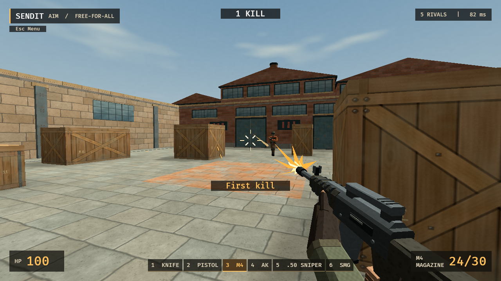

# Sendit

Sendit is an original Rust first-person game. Jump into a free-for-all against bots, host a 5v5 bomb match for friends, run a two-player practice drill, or ride a surf course. Local and hosted games use the same 128 Hz simulation.

## Play bot deathmatch

| Download | Launch after extracting |
| --- | --- |
| [macOS Apple Silicon (.zip)](https://github.com/mingley/sendit/raw/refs/heads/main/dist/sendit-macos-arm64.zip) | Double-click `Sendit.app`. You can also drag it to Applications. |
| [Windows x86-64 (.zip)](https://github.com/mingley/sendit/raw/refs/heads/main/dist/sendit-windows-x86_64.zip) | Open the extracted folder and double-click `sendit-client.exe`. |
| [Linux x86-64 (.tar.xz)](https://github.com/mingley/sendit/raw/refs/heads/main/dist/sendit-linux-x86_64.tar.xz) | Open a terminal in the extracted folder and run `./sendit-client`. |

Click the game window to start on Aim with **five bots at 40% skill**. Before starting, press **Left / Right** to choose 1–9 bots or **Down / Up** to change their skill. The game creates a private match on your machine and works offline.

Move with **WASD**, aim with the mouse, **left-click** to attack, **R** to reload and **Space** to jump. Every orange player is a rival. Hold **Tab** for the leaderboard. After a death, you return in one second with your selected weapon. Press **Esc** during a match for **Resume** and **Quit to desktop**. Click either button or use the arrow keys and **Enter**.

| Key | Deathmatch weapon | How it plays |
| --- | --- | --- |
| **1** | Knife | Swing at an opponent within reach. |
| **2** | Pistol | Click for each shot. |
| **3** | M4 | Automatic rifle and starting weapon. |
| **4** | AK | Slower automatic fire with a stronger kick. |
| **5** | .50 sniper | Hold the right mouse button to use the scope. Click once per shot. |
| **6** | SMG | Fast automatic fire and a 36-round magazine. |

Your equipped weapon kicks as it fires. A cross at the reticle confirms a server-registered hit. Incoming damage flashes red on the side the hit came from. Nearby fire has a separate amber indicator. In stereo, your own shots and steps are centered. Other players’ sounds change side as you turn and become quieter and more muffled with distance and cover. Footsteps on stone, wood and metal each have a different sound.

The Mac build requires Apple Silicon and macOS 11 or later. It uses an ad-hoc signature. If macOS asks you to verify the developer, compare `shasum -a 256 ~/Downloads/sendit-macos-arm64.zip` with the published checksum. After attempting to open Sendit, you can approve this app under **System Settings → Privacy & Security → Open Anyway**. On macOS 11–12, use **System Preferences → Security & Privacy → General**. [Download checksums](https://github.com/mingley/sendit/blob/main/dist/SHA256SUMS) · [Apple’s first-open instructions](https://support.apple.com/guide/mac-help/mh40616/mac)

To start with different settings, run `open -n /Applications/Sendit.app --args --bots 3 --bot-skill 0.2` on Mac, `./sendit-client --bots 3 --bot-skill 0.2` on Linux or `.\sendit-client.exe --bots 3 --bot-skill 0.2` in PowerShell.



## Build from source or host a drill

Install Rust with rustup. On an Apple Silicon Mac, install the Xcode Command Line Tools with `xcode-select --install`. The native game uses Metal and CoreAudio. On Debian or Ubuntu, install a C toolchain, pkg-config, and ALSA development headers (`build-essential pkg-config libasound2-dev libxkbcommon-x11-0`). The Linux client uses X11 or XWayland and a Vulkan-capable graphics driver. Headphones or speakers provide positional sound cues. The dedicated server runs without a window or audio device.

```sh
cargo build --release --locked --workspace
target/release/sendit-client
```

For a multiplayer drill, start the dedicated server. The commands below use source-build paths. With the download, run the executables in the extracted folder and pass `--bin-dir .` to the Python benchmark wrapper.

```sh
target/release/sendit-server --bind 0.0.0.0:27015 --map drill --mode practice
```

In another terminal on the same machine, join with the following command. A second player can use the host's IP in place of `127.0.0.1`. Allow inbound UDP on the port you chose.

```sh
target/release/sendit-client --connect 127.0.0.1:27015 --name Pilot
```

Click to capture the mouse. F5 resets the practice drill, F3 shows authoritative shot diagnostics, F1 shows controls, and Esc opens the game menu. Mouse sensitivity defaults to 0.001 radians per unit of relative motion (`--sensitivity 0.001`). On macOS these deltas come from AppKit and can reflect the system’s pointer settings.

## Repeat a peek or a match

```sh
cargo test --release --locked --workspace
target/release/sendit-probe verify --server target/release/sendit-server
target/release/sendit-probe verify-arsenal --server target/release/sendit-server
target/release/sendit-bench record-peek --out peek.jsonl
target/release/sendit-bench replay --file peek.jsonl --friction 5.2
target/release/sendit-bench replay --file peek.jsonl --friction 8
python3 scripts/benchmark.py server --players 10 --seconds 10
python3 scripts/benchmark.py client --players 10 --seconds 30 --width 1920 --height 1080
```

The UDP verifier starts two fresh servers and drives two clients per run, once locally and once with delay, jitter, and loss. The peek fixture records two actors' input tracks with the same approach to the corner, then measures distance and elapsed ticks until each actor can fire a settled first shot. `Tuning::default()` in `crates/sim/src/motion.rs` sets friction, acceleration, movement spread and recovery. `crates/sim/src/rifle.rs` holds the fixed angular recoil pattern. To try the new friction live, start the host with `--friction 8`. Connected clients receive the server's tuning.

The desktop playtest drives the release game with mouse and keyboard events on a private Linux X11 display. Install `xvfb x11-utils libxtst6 libxkbcommon-x11-0 tesseract-ocr tesseract-ocr-eng mesa-vulkan-drivers python3-pil python3-numpy` and run the following after building. The output directory holds screenshots, game logs and the playtest report. The separate `verify-arsenal` command uses two network clients to check weapon selection, damage direction, range, reloads and respawns against the live server.

```sh
python3 scripts/playtest-desktop.py --bin-dir target/release --output-dir /tmp/sendit-playtest
```

To capture actual play, add `--record session.jsonl` to a client, or to the server to collect input from every connected player. Choose a new filename for each recording. Use `sendit-client --replay session.jsonl` to replay the first track on a fresh matching map and `python3 scripts/benchmark.py server --map drill --replay session.jsonl` for occupied server measurements. Replaying fewer recorded tracks than available slots repeats tracks. Scripted workloads have a separate source label.

## Competitive and deathmatch

```sh
target/release/sendit-server --mode competitive --map relay --max-players 10
target/release/sendit-server --mode deathmatch --map drill --loadout armored
target/release/sendit-probe verify-rules --server target/release/sendit-server
```

Start one host per port. Competitive balances Terrorists and Counter-Terrorists with up to five players on each side. Relay has two marked sites, outer lanes and a central connector. The round starts when both teams have a player. Buy for 10 seconds, then attack or defend for 105 seconds. The carrier holds E while stationary on a site for 3 seconds to plant. G drops the pack and E recovers it. Defenders have 35 seconds after planting to complete a 5-second defuse, including when the last attacker has died.

Each player has one life per live round. Use Tab for scores and to cycle living teammates while spectating. Both sides start with a knife, a pistol, a 12-round M4 and $1,200. B buys the full arsenal, a 30-round M4 and 50 armor for $1,200 during buy time. The server awards money for outcomes, kills, and objective work. Survivors can carry their kit forward. Players who join a live round spectate until the next buy phase. Squads swap sides after 12 rounds. First to 13 wins, and 12–12 is a draw. [Relay scoreboard](docs/images/relay.png)

Deathmatch continually respawns players. Select `--loadout light`, `standard`, or `armored` at startup. On a map without bomb sites, competitive uses elimination and the round clock, so the same geometry can host other rulesets.

## Host a community server

The Linux dedicated server embeds the stock arenas and has no display or audio dependency. Set the map, rules, capacity, optional password, and rotation on the command line. This example reads a password already set in the operator's environment.

```sh
target/release/sendit-server --name "Relay Club" --bind 0.0.0.0:27015 \
  --mode competitive --max-players 10 --password-env SENDIT_PASSWORD \
  --rotation relay,drill --rotate-seconds 900
target/release/sendit-client --connect 127.0.0.1:27015 --password-env SENDIT_PASSWORD
```

Use the host's local console for `status`, `kick ID`, `map NAME`, `next`, `restart`, or `quit`. Closing stdin leaves the server running. Map changes keep connected clients in the session. Set `--rotate-seconds 0` for manual rotation.

For LAN discovery, run `target/release/sendit-server discover`. The default broadcast targets UDP port 27015. For a different subnet or game port, pass `--target BROADCAST_IP:PORT`. Join the returned game address with `sendit-client --connect`.

A community can also run an opt-in directory. Start the first command on the directory host. On the game host and on players' machines, replace `DIRECTORY_IP` with the directory's address.

```sh
target/release/sendit-server directory --bind 0.0.0.0:27016
target/release/sendit-server --name "Relay Club" --mode competitive --public-list DIRECTORY_IP:27016
target/release/sendit-server list --directory DIRECTORY_IP:27016
target/release/sendit-probe verify-hosting --server target/release/sendit-server
```

Public listing requires the game host's UDP endpoint to be reachable by players. The directory verifies the announcing endpoint and expires silent entries after 60 seconds. Direct-IP joining continues when the directory is offline. The game protocol sends UDP packets, including the join password, in cleartext.

## Bots, Aim and Surf

```sh
target/release/sendit-server --mode deathmatch --map aim --fill 10 --bot-skill 0.65
target/release/sendit-server --mode competitive --map relay --fill 10 --bot-skill 0.8
target/release/sendit-server --mode surf --map surf
target/release/sendit-probe verify-bots --server target/release/sendit-server
target/release/sendit-bench surf
```

Each server command is a separate game. `--bots N` reserves a fixed number of AI players. `--fill N` adds extra bots to reach a target population and frees slots for joining humans. `--bot-team auto|t|ct` selects team assignment. Skill ranges from 0 to 1 and affects reactions, aim error, and decisions. Set `--bot-seed N` to repeat their choices. Bots send normal player inputs, use sight and audible cues, and can carry, plant, or defuse the pack.

Aim can host a deathmatch or a round-based duel. Surf has a marked start, connected ramp sections, two airborne transfers and a finish gate. Hold forward from the start to ride the center line, then try steering the outer banks. F5 resets the course. The surf benchmark compares every fixed-tick state across 30, 60, 144 and 240 Hz render schedules.

For custom maps, install a JSON file on the server and start it by name. The client downloads and validates the geometry on join and map change. [Map format and installation](docs/maps.md)

The provisional target is 240 FPS at 1920×1080 on a Ryzen 5 7600, GeForce RTX 4060 8 GB and 32 GB of DDR5. The server target is ten occupied slots with a p99 tick below 7.8125 ms. The benchmark guide includes the tested hardware, measured workloads and reproduction commands. [Performance measurements](docs/performance.md)
