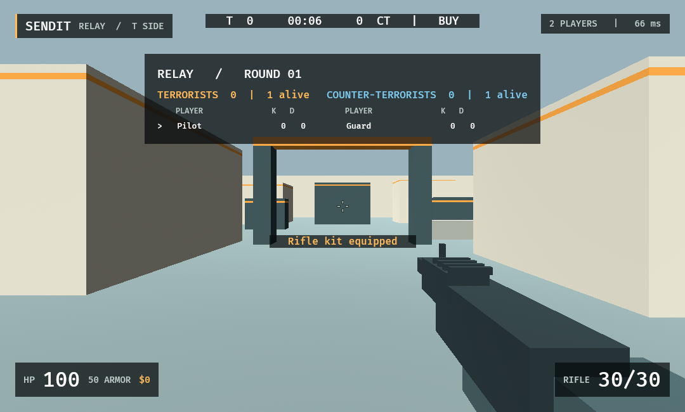

# Sendit

Sendit is an original Rust tactical first-person game for community-hosted matches. A native Bevy client and a headless dedicated server share a 128 Hz movement and rifle simulation. Play a two-player practice drill, a 5v5 bomb match, or continuous deathmatch over direct UDP. The release includes client prediction, input replay, and occupied-match benchmarks.

The provisional client target is 240 FPS at 1920×1080 on a Ryzen 5 7600, GeForce RTX 4060 8 GB, and 32 GB of DDR5. The server target is ten occupied slots with a p99 tick below 7.8125 ms. Targets require measured results for the specified workload.



## Build and join a drill

Install Rust with rustup. On Debian or Ubuntu, install a C toolchain, pkg-config, and ALSA development headers (`build-essential pkg-config libasound2-dev`). To run the desktop game, use an X11 or XWayland display, a Vulkan-capable graphics driver, and an audio output for positional cues. The dedicated server runs without a window or audio device.

```sh
cargo build --release --locked --workspace
target/release/sendit-server --bind 0.0.0.0:27015 --map drill --mode practice
```

In another terminal on the same machine, join with the following command. A second player can use the host's IP in place of `127.0.0.1`. Allow inbound UDP on the port you chose.

```sh
target/release/sendit-client --connect 127.0.0.1:27015 --name Pilot
```

Click to capture the mouse. Use WASD to move, Space to jump, the left mouse button to fire, and R to reload. F5 resets the practice drill, F3 shows authoritative shot diagnostics, F1 shows controls, and Esc releases the cursor. Mouse sensitivity is radians per raw device count (`--sensitivity 0.002` by default).

## Repeat a peek or a match

```sh
cargo test --release --locked --workspace
target/release/sendit-probe verify --server target/release/sendit-server
target/release/sendit-bench record-peek --out peek.jsonl
target/release/sendit-bench replay --file peek.jsonl --friction 5.2
target/release/sendit-bench replay --file peek.jsonl --friction 8
python3 scripts/benchmark.py server --players 10 --seconds 10
python3 scripts/benchmark.py client --players 10 --seconds 30 --width 1920 --height 1080
```

The UDP verifier starts two fresh servers and drives two clients per run, once locally and once with delay, jitter, and loss. The peek fixture records two actors' input tracks with the same approach to the corner, then measures distance and elapsed ticks until each actor can fire a settled first shot. `Tuning::default()` in `crates/sim/src/motion.rs` sets friction, acceleration, movement spread and recovery. `crates/sim/src/rifle.rs` holds the fixed angular recoil pattern. To try the new friction live, start the host with `--friction 8`. Connected clients receive the server's tuning.

To capture actual play, add `--record session.jsonl` to a client, or to the server to collect input from every connected player. Choose a new filename for each recording. Use `sendit-client --replay session.jsonl` to replay the first track on a fresh matching map and `python3 scripts/benchmark.py server --map drill --replay session.jsonl` for occupied server measurements. Replaying fewer recorded tracks than available slots repeats tracks. Scripted workloads have a separate source label.

## Competitive and deathmatch

```sh
target/release/sendit-server --mode competitive --map relay --max-players 10
target/release/sendit-server --mode deathmatch --map drill --loadout armored
target/release/sendit-probe verify-rules --server target/release/sendit-server
```

Start one host per port. Competitive balances Terrorists and Counter-Terrorists with up to five players on each side. Relay has two marked sites, outer lanes and a central connector. The round starts when both teams have a player. Buy for 10 seconds, then attack or defend for 105 seconds. The carrier holds E while stationary on a site for 3 seconds to plant. G drops the pack and E recovers it. Defenders have 35 seconds after planting to complete a 5-second defuse, including when the last attacker has died.

Each player has one life per live round. Use Tab for scores and to cycle living teammates while spectating. Both sides start with a 12-round rifle and $1,200. B buys the 30-round kit with 50 armor for $1,200 during buy time. The server awards money for outcomes, kills, and objective work. Survivors can carry their kit forward. Squads swap sides after 12 rounds. First to 13 wins, and 12–12 is a draw.

Deathmatch continually respawns players. Select `--loadout light`, `standard`, or `armored` at startup. On a map without bomb sites, competitive uses elimination and the round clock, so the same geometry can host other rulesets.
